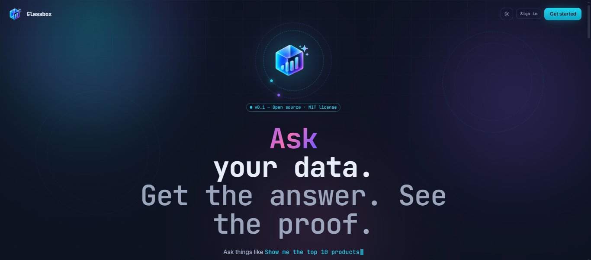

# Glassbox

**Ask your data. Get the answer. See the proof.**

A local-first, provider-agnostic analytics workspace. Upload a file or connect a
database, ask a question in plain English, and get back SQL, Python, DAX,
interactive charts, and a transparent trace — never an opaque answer.

---

## Table of contents

1. [Highlights](#highlights)
2. [Architecture](#architecture)
3. [Tech stack](#tech-stack)
4. [Quick start](#quick-start)
5. [Environment variables](#environment-variables)
6. [Feature guide](#feature-guide)
   - [Data sources](#data-sources)
   - [Agent pipeline](#agent-pipeline)
   - [Inspector](#inspector)
   - [Charts and KPIs](#charts-and-kpis)
   - [Filters](#filters)
   - [Conversation context](#conversation-context)
   - [DAX generation](#dax-generation)
   - [Edit-and-run](#edit-and-run)
   - [Templates](#templates)
   - [Metrics (semantic layer)](#metrics-semantic-layer)
   - [History](#history)
   - [Audit log](#audit-log)
   - [Export](#export)
   - [Command palette](#command-palette)
   - [Keyboard shortcuts](#keyboard-shortcuts)
   - [Onboarding tour](#onboarding-tour)
   - [Dark / light theme](#dark--light-theme)
   - [Auto-dashboard](#auto-dashboard)
   - [Anomaly detection](#anomaly-detection)
   - [Explain this SQL](#explain-this-sql)
   - [Why this query](#why-this-query)
   - [Next-question suggestions](#next-question-suggestions)
   - [Query-history autocomplete](#query-history-autocomplete)
   - [Chart drill-down](#chart-drill-down)
   - [Column drill-down](#column-drill-down)
   - [Saved analyses / pinning](#saved-analyses--pinning)
   - [Guest mode](#guest-mode)
   - [Settings](#settings)
   - [Auth and password reset](#auth-and-password-reset)
7. [Agent architecture](#agent-architecture)
8. [Service architecture](#service-architecture)
9. [Security model](#security-model)
10. [API reference](#api-reference)
11. [Data model](#data-model)
12. [Testing](#testing)
13. [Deployment](#deployment)
14. [Known issues / roadmap](#known-issues--roadmap)
15. [License](#license)

---

## Highlights

- **Multi-provider LLM** — Gemini, OpenAI, Anthropic, Ollama, OpenRouter, Groq,
  Cerebras, or any OpenAI-compatible endpoint. Swap with 4 lines in `.env`.
- **Read-only by construction** — the SQL layer rejects anything that isn't
  `SELECT` or `WITH`. Verified at the DuckDB level, not by prompt.
- **Transparent** — every run returns the SQL, Python, DAX, chart, assumptions,
  quality review, and a millisecond-timed execution trace.
- **In-process data engine** — DuckDB reads CSV, TSV, XLSX, XLS, Parquet,
  JSON, and JSONL, and connects to Postgres / MySQL / SQLite. No server, no ETL.
- **Conversational** — follow-up questions reuse prior SQL and metrics.
- **Filter-bar scoping** — constrain datasets by column before the LLM even sees
  them. Impossible to escape.
- **Auditable** — every security-relevant action is logged.
- **Local-first** — SQLite for app metadata. Zero infra required.
- **49 backend tests, zero skips** — config, imports, all 18 routers, HTTP smoke,
  SSRF, crypto, file signatures, sanitizer.

---

## Architecture

```
┌─────────────────────────────────────────────────────────────┐
│                        Frontend (React)                     │
│  Vite · TypeScript · Tailwind v4 · Recharts · Monaco        │
└──────────────────────────┬──────────────────────────────────┘
                           │ SSE + REST
┌──────────────────────────▼──────────────────────────────────┐
│                       Backend (FastAPI)                     │
│                                                             │
│  ┌──────────┐  ┌──────────┐  ┌──────────┐  ┌──────────┐   │
│  │   SQL    │  │  Python  │  │   DAX    │  │   Viz    │   │
│  │  Agent   │  │  Agent   │  │  Agent   │  │  Agent   │   │
│  └────┬─────┘  └────┬─────┘  └────┬─────┘  └────┬─────┘   │
│       │             │             │             │         │
│       └─────────────┴──────┬──────┴─────────────┘         │
│                            │                               │
│              ┌─────────────▼─────────────┐                 │
│              │       Orchestrator        │                 │
│              │  (SSE streaming pipeline) │                 │
│              └─────────────┬─────────────┘                 │
│                            │                               │
│       ┌────────────────────┼────────────────────┐          │
│       │                    │                    │          │
│  ┌────▼─────┐        ┌─────▼────┐        ┌─────▼─────┐   │
│  │ LLM      │        │  DuckDB  │        │  Sandbox  │   │
│  │ Provider │        │  Engine  │        │ (Docker)  │   │
│  └──────────┘        └──────────┘        └───────────┘   │
│                                                             │
│  ┌────────────────────────────┐   ┌─────────────────────┐ │
│  │  SQLite (app metadata)     │   │  Local file storage │ │
│  │  users · datasets · runs   │   │  uploads · artifacts│ │
│  │  audit · sources · metrics │   │                     │ │
│  └────────────────────────────┘   └─────────────────────┘ │
└─────────────────────────────────────────────────────────────┘
```

---

## Tech stack

| Layer | Technology |
|---|---|
| **Backend** | FastAPI + Python 3.11+ (verified on 3.14) |
| **LLM** | Gemini / OpenAI / Anthropic / Ollama / OpenRouter / Groq / Cerebras / any OpenAI-compatible |
| **Data engine** | DuckDB (in-process OLAP) |
| **Execution** | Docker sandbox (optional) or local subprocess |
| **Database** | SQLite via SQLAlchemy 2.0 async |
| **Auth** | JWT (HS256) + bcrypt |
| **Email** | aiosmtplib (SMTP — Gmail / SendGrid / Mailgun / SES / etc.) |
| **Rate limiting** | slowapi (memory:// or Redis) |
| **Frontend** | React 19 + Vite 6 + TypeScript 5.7 |
| **Styling** | Tailwind CSS v4 |
| **Charts** | Recharts 2.15 |
| **Editor** | Monaco Editor (SQL, Python, DAX) |
| **Streaming** | Server-Sent Events (SSE) |
| **Testing** | pytest 8 + pytest-asyncio (49 backend tests) |

---

## Quick start

### Prerequisites

- Python 3.11+ (3.14 verified)
- Node.js 20+
- (Optional) Docker for sandboxed Python execution

### 1. Clone and configure

```bash
git clone <your-repo> ai-data-analyst
cd ai-data-analyst
cp .env.example .env
```

Edit **`.env` at the repo root** (this is the canonical file — see
[Environment variables](#environment-variables)) and set at minimum:

```bash
LLM_PROVIDER=gemini
LLM_API_KEY=your-key-here
LLM_MODEL=gemini-2.5-flash
SECRET_KEY=<random-64-char-string>
JWT_SECRET_KEY=<another-random-string>
```

Generate a key:

```bash
python -c "import secrets; print(secrets.token_urlsafe(48))"
```

### 2. Backend

```bash
cd backend
python -m venv .venv

# Windows
.venv\Scripts\activate
# macOS/Linux
source .venv/bin/activate

pip install -r requirements.txt
uvicorn app.main:app --reload --port 8000
```

The first boot will:

- Create SQLite tables
- Run idempotent migrations for existing installs
- Seed 10 built-in templates
- Seed 6 built-in business metrics
- Create the anonymous user (single-user mode)
- Prune audit events older than 90 days
- Verify all 18 routers are reachable (`audit_routes`)
- Print a `startup` log line

Open http://localhost:8000/docs for the auto-generated API reference
(when `APP_DEBUG=true`).

### 3. Frontend

```bash
cd frontend
npm install
npm run dev
```

Open http://localhost:5173.

### 4. Use it

1. **Data Sources** → upload a CSV (or connect a database)
2. **Home** → pick a suggested question
3. **Workspace** → watch the agent stream the answer
4. **Inspector** → inspect SQL, Python, DAX, trace, assumptions
5. **⌘K** → command palette for anything else

---

## Environment variables

> **Note on `.env` files:** `backend/app/config.py` reads from both
> `backend/.env` and the repo-root `.env`. Precedence: process env >
> later `env_file` entry (root `.env`) > earlier (`backend/.env`) > defaults.
> **Use the root `.env` as the single source of truth.** Consolidation of
> `backend/.env.example` is planned — see [Known issues](#known-issues--roadmap).

### LLM

| Variable | Default | Purpose |
|---|---|---|
| `LLM_PROVIDER` | `gemini` | `gemini` \| `openai` \| `anthropic` \| `ollama` \| `openai_compatible` |
| `LLM_API_KEY` | - | Provider API key |
| `LLM_MODEL` | `gemini-2.5-flash` | Model identifier |
| `LLM_BASE_URL` | - | Required for `openai_compatible` and `ollama` |
| `LLM_TEMPERATURE` | `0` | Sampling temperature |
| `LLM_MAX_TOKENS` | `8192` | Max output tokens |

### App

| Variable | Default | Purpose |
|---|---|---|
| `APP_NAME` | Glassbox | Display name |
| `APP_ENV` | `development` | Environment |
| `APP_DEBUG` | `true` | Enables `/docs` and verbose errors |
| `APP_HOST` | `0.0.0.0` | Bind host |
| `APP_PORT` | `8000` | Bind port |
| `SECRET_KEY` | - | Derived for credential encryption |
| `CORS_ORIGINS` | `http://localhost:5173` | Comma-separated allowed origins |
| `DISPLAY_TIMEZONE` | `Asia/Kolkata` | ISO timezone for timestamps |
| `LOG_LEVEL` | `INFO` | Structured log level |

### Storage

| Variable | Default | Purpose |
|---|---|---|
| `DATABASE_URL` | `sqlite+aiosqlite:///./data/app.db` | SQLAlchemy URL |
| `UPLOAD_DIR` | `./data/uploads` | Where uploaded files live |
| `ARTIFACT_DIR` | `./data/artifacts` | Sandbox scratch + outputs |
| `DUCKDB_TEMP_DIR` | `./data/duckdb_temp` | DuckDB scratch |
| `MAX_UPLOAD_SIZE_MB` | `100` | Upload size cap |
| `UPLOAD_SIGNATURE_CHECK_ENABLED` | `true` | Magic-byte verification on upload |
| `UPLOAD_STREAM_CHUNK_BYTES` | `1048576` | Streaming read chunk size |

### DuckDB

| Variable | Default | Purpose |
|---|---|---|
| `DUCKDB_MEMORY_LIMIT` | `2GB` | DuckDB memory ceiling |
| `DUCKDB_THREADS` | `4` | Parallel worker count |

### Sandbox

| Variable | Default | Purpose |
|---|---|---|
| `SANDBOX_ENABLED` | `false` | `true` uses Docker; `false` uses local subprocess |
| `SANDBOX_IMAGE` | `ai-data-analyst-sandbox:latest` | Docker image |
| `SANDBOX_CPU_LIMIT` | `2.0` | CPU cores |
| `SANDBOX_TIMEOUT_SECONDS` | `30` | Wall time |
| `SANDBOX_MEMORY_LIMIT_MB` | `2048` | Memory cap in Docker mode |
| `SANDBOX_NETWORK_DISABLED` | `true` | Disable network in Docker mode |
| `SANDBOX_MAX_OUTPUT_BYTES` | `1048576` | Truncate stdout at 1 MB |

### Guardrails

| Variable | Default | Purpose |
|---|---|---|
| `MAX_QUERY_ROWS` | `100000` | Row cap per DuckDB query |
| `QUERY_TIMEOUT_SECONDS` | `60` | Query timeout |
| `MAX_CONCURRENT_RUNS` | `5` | Concurrent orchestrator runs |

### Database connectors / SSRF guard

| Variable | Default | Purpose |
|---|---|---|
| `CONNECTOR_ALLOW_PRIVATE_HOSTS` | `false` | Allow connections to private/loopback IPs |
| `CONNECTOR_ALLOWLIST` | - | Comma-separated hostnames or CIDRs — only these allowed |
| `CONNECTOR_BLOCKLIST` | (sensible defaults: localhost, `127.0.0.0/8`, `::1`, `169.254.0.0/16`, metadata hosts) | Always rejected, even if public |
| `CONNECTOR_CONNECT_TIMEOUT_SECONDS` | `10` | TCP + handshake timeout |

### Auth

| Variable | Default | Purpose |
|---|---|---|
| `AUTH_ENABLED` | `false` | `false` = single-user anonymous mode |
| `GUEST_MODE` | `false` | When auth is on: allow read-only guest browsing |
| `JWT_SECRET_KEY` | - | JWT signing key (rotate in production) |
| `JWT_ALGORITHM` | `HS256` | JWT algorithm |
| `JWT_ACCESS_TOKEN_MINUTES` | `1440` | Token lifetime (24h) |
| `AUTH_MIN_PASSWORD_LENGTH` | `8` | Min password length |
| `AUTH_RESET_TOKEN_MINUTES` | `30` | Password reset link validity |
| `AUTH_SHOW_RESET_LINK` | `false` | Dev-only: expose reset URL in API response |
| `AUTH_BACKOFF_ENABLED` | `true` | Per-account exponential backoff on login failures |
| `AUTH_BACKOFF_THRESHOLD` | `3` | Failures before any delay |
| `AUTH_BACKOFF_BASE_SECONDS` | `1.0` | First delay after threshold |
| `AUTH_BACKOFF_MULTIPLIER` | `2.0` | Growth factor per extra failure |
| `AUTH_BACKOFF_MAX_SECONDS` | `300` | Hard cap (5 minutes) |
| `AUTH_BACKOFF_RESET_MINUTES` | `60` | Idle window before counter reset |

### Trusted proxy

| Variable | Default | Purpose |
|---|---|---|
| `TRUSTED_PROXY_COUNT` | `0` | Nth-from-right `X-Forwarded-For` entry to trust. `0` = ignore XFF |
| `TRUSTED_PROXY_IPS` | - | Optional IP/CIDR allowlist for the immediate peer |

### SMTP (password reset email)

| Variable | Default | Purpose |
|---|---|---|
| `SMTP_ENABLED` | `false` | `true` emails reset links; `false` logs them |
| `SMTP_HOST` | - | e.g. `smtp.gmail.com` |
| `SMTP_PORT` | `587` | 587 (STARTTLS), 465 (SSL), 25 (plain) |
| `SMTP_USERNAME` | - | SMTP user |
| `SMTP_PASSWORD` | - | SMTP password or app password |
| `SMTP_FROM_EMAIL` | - | From address |
| `SMTP_FROM_NAME` | Glassbox | From display name |
| `SMTP_USE_TLS` | `true` | STARTTLS |
| `SMTP_USE_SSL` | `false` | Implicit TLS |
| `SMTP_TIMEOUT_SECONDS` | `15` | Send timeout |

### Rate limiting

| Variable | Default | Purpose |
|---|---|---|
| `RATE_LIMIT_ENABLED` | `true` | Kill switch |
| `RATE_LIMIT_LOGIN` | `10/minute` | Login attempts |
| `RATE_LIMIT_REGISTER` | `5/hour` | Registrations |
| `RATE_LIMIT_FORGOT` | `5/hour` | Password reset requests |
| `RATE_LIMIT_RESET` | `10/hour` | Password reset submissions |
| `RATE_LIMIT_CHAT` | `30/minute` | Analysis runs |
| `RATE_LIMIT_EXECUTE` | `60/minute` | Edit-and-run executions |
| `RATE_LIMIT_STORAGE` | `memory://` | `memory://` or `redis://...` |

### News (public landing page)

| Variable | Default | Purpose |
|---|---|---|
| `NEWS_API_KEY` | - | Provider API key (optional — landing degrades gracefully) |
| `NEWS_PROVIDER` | auto-detected | `currents` \| `newsapi` \| `guardian` |
| `NEWS_PROVIDER_URL` | - | Override the provider URL |

### Audit

| Variable | Default | Purpose |
|---|---|---|
| `AUDIT_RETENTION_DAYS` | `90` | Prune events older than this. `0` = keep forever |

---

## Feature guide

### Data sources

**Location:** `/sources`

Two ways to bring data in:

#### File upload

Drag-and-drop or click to upload:

- CSV / TSV
- XLSX / XLS (converted to CSV server-side, BOM-stripped)
- Parquet
- JSON / JSONL

On upload, the backend:

1. **Verifies the file's content against its declared extension** (magic
   bytes — a PNG renamed `.csv` is rejected)
2. Streams the read with a hard `MAX_UPLOAD_SIZE_MB` cap
3. Saves the file to `UPLOAD_DIR`
4. Profiles it with DuckDB (`read_csv_auto` / `read_parquet` / `read_json_auto`)
5. Detects the delimiter, types, encoding, and BOM
6. Computes per-column stats: null rate, cardinality, sample rows
7. Registers a view named `<sanitized_stem>_<uuid6>`
8. Persists a `Dataset` row in SQLite

Multi-file upload: drag N files, they queue and upload in a bounded concurrency
pool with per-file retry.

Click any column chip on a dataset card to open **column drill-down** —
histogram, top values, null rate, sample rows.

#### Database connections

Click **Connect source** to open the connection wizard:

- **PostgreSQL** — also works for Aurora PG, Azure Database for PostgreSQL
- **MySQL / MariaDB** — also works for Aurora MySQL
- **SQLite** — point at a `.db` file

The host/port pair is validated by an **SSRF guard** before any connection is
attempted — private, loopback, link-local, and cloud-metadata addresses are
rejected unless explicitly allowlisted.

Credentials are encrypted at rest with a Fernet key derived from `SECRET_KEY`.
Never stored in plaintext.

On save, the connector:

1. Attaches the source to DuckDB via native `ATTACH`
2. Discovers visible schemas and tables
3. Caches the schema so the UI can render it without reconnecting
4. Records connection health (`healthy` / `error`)

At query time, each remote table is exposed as a local view with a sanitized
name like `public_orders_1a2b3c`. **Cross-source joins work out of the box** —
the LLM sees a flat namespace.

---

### Agent pipeline

**Location:** `/workspace`

When you ask a question, the orchestrator runs a sequence of agents. Each step
emits a Server-Sent Event that the frontend renders live.

| Step | Agent | What it does |
|---|---|---|
| 1. Planning | Orchestrator | Classifies intent, assembles scope |
| 2. Schema | DuckDB | Introspects tables + samples rows for the LLM prompt |
| 3. Query | SQL Agent | Generates read-only SQL, validates via `EXPLAIN`, repairs on error |
| 4. Execute | DuckDB | Runs the query with a row cap |
| 5. Compute | Python Agent | Writes a pandas script for deeper analysis |
| 6. Translate | DAX Agent | Produces the Power BI equivalent |
| 7. Visualize | Viz Agent + KPI Agent | Chooses chart type; detects KPI-shaped answers |
| 8. Narrative | Narrative Agent | Streams the human-readable answer token by token |
| 9. Quality | Quality Agent | Reviews the answer against the rows; flags issues |
| 10. Anomalies | Anomaly service | Detects outliers; caches narrative |
| 11. Suggest | Next-questions service | Generates 3 follow-up questions |
| 12. Trace | Orchestrator | Emits the full execution timeline |
| - | Persist | Writes everything to `analysis_runs` |

**Streaming:** The narrative is streamed token by token. A live "writing…" card
appears with a blinking caret. When the structured answer lands, it replaces
the live card.

**Workspace modes:**

- **Single** — one answer at a time (classic)
- **Thread** — chat-style history for the same `conversation_id`

---

### Inspector

**Location:** right-hand panel in the workspace

Five tabs, each rendered with Monaco:

| Tab | Content |
|---|---|
| **SQL** | Generated query, syntax-highlighted, editable, ⌘↵ to run, Format chip |
| **Python** | Generated pandas script, editable, ⌘↵ to run |
| **DAX** | Power BI measure or calculated table, custom DAX syntax |
| **Trace** | Every orchestrator step with millisecond timestamps |
| **Assumptions** | Business-glossary terms used + quality review |

**Edit-and-run:** every panel has a **Run** button (or ⌘↵ inside Monaco). This
re-executes the edited code against the same datasets and sources the original
run used. A yellow `edited` chip appears when the code differs from the
generated version.

**Diff view:** click **diff** on an edited SQL or Python panel to see a
side-by-side comparison. Removed lines are red, added lines are green.

**Save to history:** after a successful edit-and-run, click **Save to history**
to persist it as a new `AnalysisRun`. It shows up in History with an `[edited]`
prefix.

---

### Charts and KPIs

**Chart types:** bar, line, area, scatter, table.

The Visualization Agent picks one based on the question and the shape of the
result. Every chart has:

- A **data table** toggle — the exact rows behind the chart
- **CSV** export — downloads the underlying data
- **PNG** export — renders the SVG to a 2× PNG on a navy background
- **Drill-down** — click any bar/point to open the row preview

**KPI cards:** when the result is a single row (all numerics become cards) or a
time series with a KPI-style question (single card with a sparkline), KPI cards
appear above the chart. No LLM call — pure Python detection.

---

### Filters

**Location:** thin bar between the workspace canvas and the composer

Add filters like:

- `region in APAC, EMEA`
- `order_date between 2025-01-01 and 2025-12-31`
- `revenue > 10000`
- `customer_email contains @gmail.com`

**How it works:** filters are applied at the **DuckDB view level**, not by
prompt. Each table is registered as a hidden `__raw` view plus a filtered view
that the agent sees. The LLM literally cannot escape the filter — the raw data
is not addressable.

**Persistence:** filters live in the URL as base64 JSON (`?f=...`). Refresh,
bookmark, and share all preserve them. Filters also persist across follow-up
questions in the same conversation.

**Cross-table:** filters apply to every table that has the matching column.

---

### Conversation context

**Location:** implicit in the workspace

Every question gets a `conversation_id` (stored in the URL as `?c=...`).
Follow-up questions in the same conversation see the **last 3 turns** —
question + SQL + row count — injected as a compact block into the SQL agent's
prompt.

Click **new conversation** to reset. The chip in the header shows the current
conversation ID.

---

### DAX generation

Every run generates the Power BI DAX equivalent of the SQL — either a
**measure** (scalar question) or a **calculated table** (grouped question).

The DAX card and inspector tab include:

- Custom DAX syntax highlighting
- **Copy** button
- **`.dax`** download
- A **"How to use in Power BI"** hint with paste instructions

DAX is **not executed** — it's a starting point for a Power BI model.

---

### Edit-and-run

**Location:** inspector SQL and Python tabs

Every generated artifact is editable in Monaco. Click **Run** (or ⌘↵) to
re-execute it against the same data scope.

**SQL results:** a live result table appears below the editor with row count,
elapsed time, and a truncation chip if the result was capped at 1,000 rows.

**Python results:** stdout is captured, with exit code and elapsed time.

**Diff mode:** toggle **diff** to see original vs. edited side-by-side.

**Save to history:** after a successful run, click **Save to history** to
persist it as a new `AnalysisRun`.

---

### Templates

**Location:** `/templates`

Reusable analysis playbooks. Two kinds:

- **Built-in** — 10 seeded templates (revenue diagnostics, top-N performers,
  time series trend, distribution check, segment comparison, data quality scan,
  period-over-period, correlation analysis, anomaly detection, customer
  segmentation). Read-only.
- **Custom** — your own, fully editable, private to your account.

Click **Use** to run the template in the workspace. On Home, the top 3
most-used templates appear below the profile-derived suggestions.

---

### Metrics (semantic layer)

**Location:** `/metrics`

The business glossary. Define what "Revenue", "Gross margin", "Active customer"
mean in your organization. Every subsequent question uses these definitions.

Each metric has: name, category, synonyms, description, SQL expression.

**6 built-in metrics** are seeded on startup:

| Metric | Category |
|---|---|
| Revenue | Financial |
| Gross margin | Financial |
| Order count | Operations |
| Average order value | Financial |
| Customer count | Customer |
| Growth rate | Financial |

**How it affects the agent:** before each SQL call, the relevant metrics are
loaded (matched against the question text) and injected into the prompt as a
`BUSINESS GLOSSARY` block. The SQL agent is instructed to use these definitions
authoritatively.

---

### History

**Location:** `/history`

Every run persists to SQLite with: question, status, elapsed, SQL, Python, DAX,
answer payload, chart spec, trace, dataset/source IDs, conversation ID, error.

**List view:** color-coded status, relative timestamp, elapsed time, dataset
count. Filter by conversation. Star any run to pin it. **Pinned counter** in
the header.

**Detail view:** the same inspector experience as the workspace. Plus:

- **Re-run** — opens the workspace with the same question
- **Pin** — star this run
- **Full CSV** — re-runs the SQL and downloads all rows (not capped at 500)
- **JSON** — downloads the entire run as formatted JSON
- **Delete** — with confirmation
- **Next-question suggestions** — same 3 follow-ups as the workspace

---

### Audit log

**Location:** `/audit`

Every security-relevant action is logged:

| Category | Actions |
|---|---|
| Auth | register, login, login_failed, password_reset_requested, password_reset_completed |
| Datasets | upload, delete |
| Sources | create, refresh, delete |
| Runs | delete |
| Templates | create, update, delete |
| Metrics | create, update, delete |
| System | clear_runs, clear_datasets |
| Rate limiting | hit |

Each event captures: actor (user ID + denormalized username), action, target
(type + ID), details (JSON), IP, user agent, and timestamp.

**Retention:** events older than `AUDIT_RETENTION_DAYS` (default 90) are pruned
on startup.

**Never logged:** passwords, tokens, secrets, API keys, email bodies. The
`audit()` helper defensively redacts keys containing `password`, `token`,
`secret`, or `api_key`.

---

### Export

| Artifact | Format | Where |
|---|---|---|
| Chart data | CSV | Chart card |
| Chart image | PNG (2× scale) | Chart card |
| SQL query | `.sql` | Inspector SQL tab |
| Python script | `.py` | Inspector Python tab |
| DAX expression | `.dax` | Inspector DAX tab |
| Full run | JSON | History detail |
| All rows | CSV | History detail (**Full CSV** — re-runs SQL) |

---

### Command palette

**Trigger:** ⌘K (macOS) / Ctrl+K (Windows)

Search and navigate: pages, recent runs, templates, actions, plus
**inline-ask** — type a question and hit Shift+Enter to fire it in the
workspace.

**Keyboard:** `↑`/`↓` navigate, `↵` execute, `ESC` close.

---

### Keyboard shortcuts

**Trigger:** `?` opens the shortcuts modal; a command-palette entry too.

Global shortcuts (configurable in `frontend/src/features/shortcuts/registry.ts`):

- `⌘K` / `Ctrl+K` — command palette
- `⌘/` / `Ctrl+/` — toggle inspector
- `⌘J` / `Ctrl+J` — new analysis
- `?` — shortcuts modal
- `Esc` — close any modal

---

### Onboarding tour

Auto-starts on first visit (tracked in localStorage). Highlights the left rail,
top bar, home suggestions, and composer. Re-launchable from the command palette
("Restart tour").

---

### Dark / light theme

Toggle in the top bar (sun / moon). No flash on load — theme is resolved by an
inline script in `index.html` before React hydrates. Monaco editor picks up an
`aida-light` variant automatically.

---

### Auto-dashboard

**Location:** `/dashboard`

Pick a dataset → the dashboard service profiles numeric and categorical columns
and builds a starter dashboard:

- KPI cards for scalar metrics
- Time-series line chart if a date column is detected
- Category bar chart for the highest-cardinality dimension
- Distribution histogram for the widest numeric column

The dashboard is a starting point — click any tile to drill in via the
workspace.

---

### Anomaly detection

Every run gets a deterministic anomaly scan on its numeric result columns:

- **Z-score** on the primary numeric measure
- **IQR** for robustness against heavy tails
- Top outliers surfaced in a card below the chart

Anomaly **narratives** are LLM-generated and cached in
`anomaly_narratives_cache` — the cache key includes the schema hash so schema
changes invalidate stale narratives.

---

### Explain this SQL

**Location:** SQL card + inspector SQL tab

Click **Explain** to get a plain-English paragraph describing what the SQL
does, which tables it touches, which filters apply, and which joins might be
expensive. Backed by the LLM (cached per SQL text hash in `sql_explanations`).

---

### Why this query

**Location:** inspector SQL tab

Click **Why** to get the agent's decision rationale: which alternative queries
were considered, why this one was chosen, what assumptions were baked in.
Backed by the LLM (cached in `sql_rationales`).

---

### Next-question suggestions

After every successful run, the workspace shows **3 follow-up suggestions** —
e.g. "Now break that down by channel", "Compare this month vs. last". Powered by
`next_questions_service`, cached in `next_questions_cache`.

---

### Query-history autocomplete

The composer has inline autocomplete from past questions. Type 3+ characters,
hit `↓` to browse, `↵` to select. Powered by
`/api/v1/suggestions/history`.

---

### Chart drill-down

**Location:** any rendered chart

Click a bar, point, or slice → opens a `DrilldownModal` with the exact rows
that produced that element. Backed by `/api/v1/drilldown`, which re-runs the
original SQL with an added `WHERE` clause scoped to the clicked value.

Column-name sanity check: the drill-down service rejects any value that isn't a
column in the original result set.

---

### Column drill-down

**Location:** dataset cards on `/sources`

Click any column chip → opens a `ColumnModal` with:

- Null rate
- Distinct count
- Histogram (numeric / date) or top values (categorical)
- Sample rows

Backed by `/api/v1/datasets/{id}/columns/{name}`.

---

### Saved analyses / pinning

**Location:** History, Run Detail, Workspace

Star any run to pin it. Pinned runs appear on Home in the `PinnedRuns` widget
and sort to the top of History. Backed by `pinned` / `pinned_at` columns on
`analysis_runs`.

---

### Guest mode

**Toggle:** `GUEST_MODE=true` (only meaningful when `AUTH_ENABLED=true`)

Guests can **read** — browse pages, list existing data, see charts — but every
write (upload, run analysis, connect source, delete, pin) returns **403** with a
"sign in to continue" message. The frontend turns any 403 into a sign-in modal.

Public paths that bypass the guest gate:

- `/api/v1/auth/*`
- `/api/v1/news`
- `/api/v1/health`
- `/docs`, `/openapi.json`, `/redoc`

---

### Settings

**Location:** `/settings`

Six sections:

- **Account** — username, email, active status, join date, sign-out (auth on only)
- **LLM Provider** — provider, model, temperature, max tokens
- **Execution limits** — upload size, rows per query, query timeout, sandbox mode, concurrent runs
- **Storage & activity** — four stat cards + total bytes on disk
- **System** — version, environment, display timezone
- **Danger zone** — clear run history, delete all datasets (both with confirmation)

---

### Auth and password reset

**Toggle:** `AUTH_ENABLED=true` in `.env`

When enabled:

- **Register** — email, username, password (min length from `AUTH_MIN_PASSWORD_LENGTH`)
- **Login** — accepts username OR email, with per-account exponential backoff
- **JWT** — stored in localStorage, sent as `Authorization: Bearer <token>`
- **Per-user scoping** — every dataset, source, run, template, metric belongs
  to one user

**Rate limiting:** login 10/min, register 5/hr, forgot 5/hr, reset 10/hr.

**Password reset flow:**

1. `/forgot-password` — enter email
2. Backend generates a 32-byte URL-safe token, stores only its SHA-256 hash
3. If SMTP is configured, emails the reset link
4. If SMTP is off, logs the link to the server console
5. Link goes to `/reset-password?token=...`
6. Token is single-use, expires in 30 minutes

**Email enumeration is impossible** — the forgot endpoint always returns 200.

**Email delivery:** works with any SMTP provider (Gmail, Outlook, SendGrid,
Mailgun, AWS SES, Postmark, Mailtrap). When `SMTP_ENABLED=false`, emails are
skipped and links are only logged.

**Fail-soft:** if SMTP is down, the endpoint still returns 200.

---

## Agent architecture

The orchestrator coordinates **7 specialized agents**. Each is a thin wrapper
around one LLM concern.

### SQL Agent — `backend/app/agents/sql_agent.py`

Generates DuckDB SQL from natural language + schema + business glossary + prior
conversation context.

- Uses JSON-mode LLM output
- Validates with `EXPLAIN` before executing
- On error, re-prompts once with the parser error message
- Never emits writes — the DuckDB layer rejects them independently

### Python Agent — `backend/app/agents/python_agent.py`

Writes a compact pandas script. Not executed here — the orchestrator hands it
to the sandbox so the agent stays pure.

### DAX Agent — `backend/app/agents/dax_agent.py`

Reads the schema and the SQL that was already generated, produces the Power BI
equivalent (measure or calculated table, based on question shape).

### Visualization Agent — `backend/app/agents/visualization.py`

Chooses a chart type and encodes a spec. Falls back to column-type inference if
the LLM returns garbage, so a chart always renders.

### Narrative Agent — `backend/app/agents/narrative.py`

Turns rows into a human-readable answer. Two modes:

- **Streaming** — token-by-token, strict text format (summary + FINDINGS + CAVEATS)
- **Fallback** — one-shot JSON if streaming fails

The prompt hard-restricts the model to facts visible in the rows.

### Quality Agent — `backend/app/agents/quality.py`

Reviews the answer against the rows:

- Local checks: small sample warning, entirely-null columns, high null rate
- LLM review: confidence (high / medium / low), warnings, verdict

### KPI Agent — `backend/app/agents/kpi.py`

Deterministic detection — **no LLM call**:

1. Single row → one card per numeric column
2. Time series + KPI-style question + one numeric column → one card with a sparkline
3. Otherwise → no cards

---

## Service architecture

Beyond agents, these services do the non-LLM and cached-LLM work:

| Service | File | Role |
|---|---|---|
| Orchestrator | `orchestrator.py` | SSE pipeline coordinator |
| DuckDB | `duckdb_service.py` | Query engine, timeout, `_strip_bom_in_place`, filter views |
| Connector | `connector_service.py` | Postgres / MySQL / SQLite attach, SSRF-guarded |
| Sandbox | `sandbox_service.py` | Docker or local subprocess Python execution |
| Profiling | `profiling_service.py` | Per-column stats on upload |
| Semantic | `semantic_service.py` | Glossary injection into SQL prompt |
| Context | `context_service.py` | Last-3-turns conversation memory |
| Suggestion | `suggestion_service.py` | Profile-derived question suggestions |
| Anomaly | `anomaly_service.py` | Z-score + IQR outlier detection, cached narratives |
| Dashboard | `dashboard_service.py` | Auto-dashboard layout for a dataset |
| Explain | `explain_service.py` | SQL → plain English (cached) |
| Rationale | `rationale_service.py` | Why this query (cached) |
| Next questions | `next_questions_service.py` | 3 follow-up questions per run (cached) |

---

## Security model

### SQL

- Only `SELECT` / `WITH` statements are allowed
- Every query wrapped in `SELECT * FROM (user_query) LIMIT max_rows`
- Forbidden keyword scan (INSERT, UPDATE, DELETE, DROP, CREATE, ALTER,
  TRUNCATE, ATTACH, COPY, PRAGMA)
- `EXPLAIN` runs before execution

### Python

- Runs in an isolated subprocess (`-I` mode) or Docker container
- CPU, memory, wall-time, filesystem, and network caps
- `PYTHON*` environment variables stripped from the child process
- Output truncated at `SANDBOX_MAX_OUTPUT_BYTES`

### Uploads

- Streaming size cap (never loads whole file into memory)
- **Magic-byte verification** — content must match declared extension
- UTF-8 BOM stripped at upload time
- Cleanup on profiling failure or delete
- No AV scanning (accepted for local single-user; revisit for multi-tenant)

### SSRF guard

- Host/port validated before any connection attempt
- Resolves to IPs and rejects private / loopback / link-local / multicast /
  reserved / cloud-metadata
- Hard-blocked names: `metadata.google.internal`, `metadata.azure.com`, etc.
- `CONNECTOR_ALLOWLIST` / `CONNECTOR_BLOCKLIST` for tightening
- **Known residual risks** (see `SECURITY.md`): DNS rebinding TOCTOU, non-standard
  IPv4 encodings

### Credentials

- Encryption: Fernet symmetric, key derived from `SECRET_KEY` via SHA-256
- Never logged
- Not returned in any API response
- `audit()` helper redacts `password` / `token` / `secret` / `api_key` keys

### Auth

- Passwords: bcrypt, cost 12
- JWT: HS256, issuer claim enforced
- Token verified on every protected endpoint
- Reset tokens: 32 bytes of entropy, SHA-256 hashed at rest, single-use,
  time-limited
- **Per-account exponential backoff** on login failures (never a permanent lockout)

### Rate limiting

- Per-user (JWT hash) for authenticated endpoints
- Per-IP for anonymous endpoints
- Configurable per endpoint

### Prompt injection

- System prompts are separated from user content
- Tool outputs are validated before reuse
- Schema is authoritative — the LLM is instructed not to invent columns

**For a full list of what's hardened, what's deliberately not, and what's still
open, see [`SECURITY.md`](./SECURITY.md).**

---

## API reference

Full interactive docs at http://localhost:8000/docs when `APP_DEBUG=true`.

All routes are mounted under `/api/v1`. The startup route audit refuses to boot
if any router import fails.

### Health

| Method | Path | Purpose |
|---|---|---|
| GET | `/api/v1/health` | Liveness + provider info + auth backoff stats |

### Auth

| Method | Path | Purpose |
|---|---|---|
| GET | `/api/v1/auth/config` | Public: `{enabled, guest_mode, min_password_length, email_enabled}` |
| POST | `/api/v1/auth/register` | Create account |
| POST | `/api/v1/auth/login` | Exchange credentials for JWT |
| GET | `/api/v1/auth/me` | Current user |
| POST | `/api/v1/auth/forgot-password` | Generate reset link |
| POST | `/api/v1/auth/reset-password` | Consume token + set password |

### Datasets

| Method | Path | Purpose |
|---|---|---|
| POST | `/api/v1/datasets/upload` | Upload + profile a file |
| GET | `/api/v1/datasets` | List current user's datasets |
| GET | `/api/v1/datasets/{id}` | Fetch one |
| GET | `/api/v1/datasets/{id}/columns/{name}` | Column drill-down (histogram, top values) |
| DELETE | `/api/v1/datasets/{id}` | Delete row + file |

### Data sources

| Method | Path | Purpose |
|---|---|---|
| POST | `/api/v1/sources/test` | Test a connection (no save) |
| POST | `/api/v1/sources` | Create + test |
| GET | `/api/v1/sources` | List |
| GET | `/api/v1/sources/{id}` | Fetch one |
| POST | `/api/v1/sources/{id}/refresh` | Re-test |
| GET | `/api/v1/sources/{id}/tables` | Table + column discovery |
| DELETE | `/api/v1/sources/{id}` | Remove |

### Chat

| Method | Path | Purpose |
|---|---|---|
| POST | `/api/v1/chat/stream` | SSE stream of a run |

### Columns (for filters)

| Method | Path | Purpose |
|---|---|---|
| GET | `/api/v1/columns` | Column metadata across datasets |

### Drilldown

| Method | Path | Purpose |
|---|---|---|
| POST | `/api/v1/drilldown` | Rows behind a clicked chart element |

### Execute (edit-and-run)

| Method | Path | Purpose |
|---|---|---|
| POST | `/api/v1/execute/sql` | Run edited SQL |
| POST | `/api/v1/execute/python` | Run edited Python |
| POST | `/api/v1/execute/save` | Persist edit-run as new run |

### Explain / Why

| Method | Path | Purpose |
|---|---|---|
| POST | `/api/v1/explain` | Plain-English SQL explanation |
| POST | `/api/v1/explain/why` | Agent rationale for this SQL |

### Conversations

| Method | Path | Purpose |
|---|---|---|
| GET | `/api/v1/conversations/{id}/runs` | All runs in a conversation |

### Dashboard

| Method | Path | Purpose |
|---|---|---|
| POST | `/api/v1/dashboard` | Build an auto-dashboard for a dataset |

### Suggestions

| Method | Path | Purpose |
|---|---|---|
| GET | `/api/v1/suggestions` | Profile-derived question suggestions |
| GET | `/api/v1/suggestions/history` | Autocomplete from past questions |

### Runs

| Method | Path | Purpose |
|---|---|---|
| GET | `/api/v1/runs` | List (paginated) |
| GET | `/api/v1/runs/pinned` | List pinned runs |
| GET | `/api/v1/runs/{id}` | Full run |
| GET | `/api/v1/runs/{id}/export.json` | Download JSON |
| GET | `/api/v1/runs/{id}/export.csv` | Re-run + download all rows |
| POST | `/api/v1/runs/{id}/pin` | Toggle pin |
| DELETE | `/api/v1/runs/{id}` | Delete |

### Templates

| Method | Path | Purpose |
|---|---|---|
| GET | `/api/v1/templates` | List built-ins + user's |
| POST | `/api/v1/templates` | Create |
| GET | `/api/v1/templates/{id}` | Fetch one |
| PATCH | `/api/v1/templates/{id}` | Update |
| POST | `/api/v1/templates/{id}/use` | Bump usage counter |
| DELETE | `/api/v1/templates/{id}` | Delete |

### Metrics

| Method | Path | Purpose |
|---|---|---|
| GET | `/api/v1/metrics` | List built-ins + user's |
| POST | `/api/v1/metrics` | Create |
| GET | `/api/v1/metrics/{id}` | Fetch one |
| PATCH | `/api/v1/metrics/{id}` | Update |
| DELETE | `/api/v1/metrics/{id}` | Delete |

### Audit

| Method | Path | Purpose |
|---|---|---|
| GET | `/api/v1/audit` | List events (filterable) |
| GET | `/api/v1/audit/actions` | Action catalog |
| GET | `/api/v1/audit/{id}` | Single event |

### System

| Method | Path | Purpose |
|---|---|---|
| GET | `/api/v1/system/info` | Config + stats |
| POST | `/api/v1/system/clear-runs` | Delete all runs |
| POST | `/api/v1/system/clear-datasets` | Delete all datasets |

### News (public)

| Method | Path | Purpose |
|---|---|---|
| GET | `/api/v1/news` | Landing-page news (degraded when no key) |

---

## Data model

### `users`

`id`, `email`, `username`, `hashed_password`, `is_active`, `is_superuser`,
`created_at`

### `datasets`

`id`, `user_id`, `name`, `table_name`, `file_path`, `file_type`, `row_count`,
`column_count`, `profile` (JSON), `created_at`

### `data_sources`

`id`, `user_id`, `name`, `kind`, `host`, `port`, `database`, `username`,
`password_enc`, `ssl_mode`, `tables` (JSON), `status`, `last_error`,
`last_tested_at`, `created_at`

### `analysis_runs`

`id`, `user_id`, `conversation_id`, `question`, `status`, `sql_text`,
`python_text`, `dax_text`, `answer`, `chart_spec` (JSON), `trace` (JSON),
`dataset_ids` (JSON), `source_ids` (JSON), `error`, `elapsed_ms`,
`pinned`, `pinned_at`, `created_at`, `completed_at`

### `templates`

`id`, `user_id`, `name`, `description`, `question`, `tags` (JSON),
`is_builtin`, `usage_count`, `created_at`

### `metrics`

`id`, `user_id`, `name`, `description`, `sql_expression`, `synonyms` (JSON),
`category`, `is_builtin`, `created_at`

### `audit_events`

`id`, `user_id`, `username`, `action`, `target_type`, `target_id`,
`details` (JSON), `ip`, `user_agent`, `created_at`

Indexed on `(action, created_at)` and `(user_id, created_at)`.

### `password_reset_tokens`

`id`, `user_id`, `token_hash`, `expires_at`, `used_at`, `created_at`

### LLM cache tables

- `sql_explanations` — explanation per (SQL, schema) hash
- `sql_rationales` — rationale per (SQL, schema) hash
- `anomaly_narratives_cache` — anomaly narratives per (schema, anomaly) hash
- `next_questions_cache` — suggestions per (SQL result) hash

**Migrations:** idempotent helpers in `app/db/session.py` (no Alembic). Startup
runs every `_migrate_*` helper in sequence; each is safe to re-run.

---

## Testing

**49 backend tests, zero skips.**

```powershell
# Windows
cd backend
.\scripts\test.ps1
.\scripts\test.ps1 -Coverage      # HTML report at htmlcov/index.html
```

```bash
# macOS / Linux / Git Bash
cd backend
./scripts/test.sh
./scripts/test.sh --cov=app --cov-report=term-missing
```

### What's covered

| File | Coverage |
|---|---|
| `tests/test_smoke.py` | Config validators, module imports, env-isolation guard |
| `tests/test_routes.py` | All 18 router prefixes reachable, root endpoint |
| `tests/test_api_smoke.py` | Health, auth config, anonymous user via `/auth/me`, root, `/openapi.json`, `/docs` off in test, 404 unknown |
| `tests/test_security_helpers.py` | SSRF guard (9 cases), crypto round-trip (3), file signatures (11), error sanitizer (4), DB-error classifier (5) |

### How test env is isolated

`tests/conftest.py` sets env vars via **direct assignment**
(`os.environ[K] = V`), **not** `os.environ.setdefault(...)`. `setdefault` is a
no-op when the key already exists — a developer shell or pre-loaded `.env`
would silently override the test env. Direct assignment makes tests
reproducible on any machine.

The test DB is a **file-backed** SQLite in a temp directory, not `:memory:`.
`session.py` creates the engine at import time with default pooling — `:memory:`
gives each connection its own empty DB, so `init_db()` writes vanish. A temp
file mirrors production exactly and is torn down by pytest.

### Not yet covered (tracked in HANDOFF "Maintenance")

- Frontend tests (vitest scaffold)
- Orchestrator end-to-end
- Full auth flow (register → login → reset)
- Upload round-trip through TestClient

---

## Deployment

> ⚠️ **Production checklist before exposing to the internet.** See
> [`SECURITY.md`](./SECURITY.md) for the full list of open risks.

### Production checklist

- [ ] Set `APP_ENV=production`, `APP_DEBUG=false`
- [ ] Generate fresh `SECRET_KEY` and `JWT_SECRET_KEY` (≥32 chars, no placeholders)
- [ ] Set `AUTH_ENABLED=true`
- [ ] Set `GUEST_MODE=false` (unless the deployment is intentionally demo)
- [ ] Configure SMTP for password resets
- [ ] Set `RATE_LIMIT_STORAGE=redis://...` if running multiple workers
- [ ] Set `SANDBOX_ENABLED=true` with a built sandbox image
- [ ] Configure `CORS_ORIGINS` for your domain
- [ ] Put a reverse proxy (nginx / Caddy) in front and set `TRUSTED_PROXY_COUNT`
- [ ] Back up `data/app.db` and `data/uploads/` regularly
- [ ] Set `AUDIT_RETENTION_DAYS` appropriately

### Docker

**`Dockerfile` and `docker-compose.yml` are not shipped yet** — the earlier
README documented a Compose setup that (a) build context points at
`./backend` but (b) mounts `/var/run/docker.sock`. **Mounting the Docker socket
into the app container grants host-level Docker control** and is a serious
risk if the app is ever compromised. A hardened Docker deployment is planned for
a future batch.

If you need to containerize now: run the backend and frontend as separate
services, use a proper sandbox image with resource limits instead of relying on
Docker-in-Docker, and **do not** mount `docker.sock`.

### One-click deploy recipes

- **Railway** — connect repo, set env vars, deploy
- **Fly.io** — `fly launch`, mount a volume at `/app/data`, set env vars
- **Render** — Web Service + Persistent Disk

---

## Known issues / roadmap

### Known issues (accepted)

- **No frontend tests** — backend is tested; the UI is not yet.
- **No CI workflows executing** — `Security.txt` at repo root needs to become
  `.github/workflows/security.yml`.
- **Dual `.env` load** — `config.py` reads both `backend/.env` and root `.env`.
  Consolidation planned.
- **`backend/.env.example`** — should be removed or symlinked to the root one.
- **No Dockerfile / docker-compose** — deployment recipes assume manual setup.
- **Login timing side channel** — unknown-account vs wrong-password differ in
  response time (`SECURITY.md` R1). Low impact for single-user; Medium for
  small-team.

### Planned

**Intelligence**
- Provider fallback chain (retry another LLM if the primary is down)
- Chart type override (user picks the type)
- PII detection + column masking
- Multi-modal input (paste a chart image)

**UX**
- Conversation threads view in History
- Multi-file upload progress UI
- Chart type override
- Frontend test scaffold

**Governance**
- Webhooks (notify on run completion, export, audit event)
- Frontend e2e test suite

**Infrastructure**
- `Dockerfile` + hardened `docker-compose.yml` (no docker.sock)
- CI: pytest + tsc + pip-audit + npm audit + gitleaks
- Consolidate env files

---

## License

MIT
<!-- <div align="center">

# 🧊 GLASSBOX

### *Transparency in Code. Power in Architecture.*

[](#)
[](#)
[](#)
[](https://github.com/KushagraKumar04/Glassbox)

> **"The best way to predict the future is to build it."**

</div>

---

## 🚧 Pardon Our Dust: The Builder is at Work 🚧

Welcome to **Glassbox**.

Right now, this repository isn't just a codebase - it's a construction site. The scaffolding is up, the foundation is poured, and the architect (that's me) is currently welding the core components together.

A **Glassbox** implies transparency - a system where you can see exactly how the gears turn. We are currently in the early, chaotic, and incredibly exciting phase of bringing this vision to life.

> [!WARNING]
> **Work in Progress:** This project is under active development. Expect breaking changes, half-built features, and the occasional spark.

---

## 📊 Current Progress

```text
Frontend Architecture  [██████████----------]  70% 🎨
Backend Systems        [██████████████------]  70% ⚙️
Core Logic Integration [██████--------------]  50% 🧠
Overall Construction   [████████------------]  45% 🚀
```

---

## 🏗️ The Blueprint (What's Being Built)

While the final shape is still taking form, the anatomy of **Glassbox** is already visible in the repository.

We are bridging the gap between a highly responsive frontend and a robust, scalable backend.

### 📁 `frontend/`

The face of the operation.

Currently being styled and optimized, with recent updates focused on `index.css` and the overall frontend architecture.

**Focus areas:**

* 🎨 Modern UI/UX
* ⚡ Responsive interactions
* 🧩 Reusable components
* 🚀 Performance optimization

### 📁 `backend/`

The engine room.

The backend architecture and data models are actively being sculpted to ensure data integrity, maintainability, and performance.

**Focus areas:**

* ⚙️ RESTful APIs
* 🗄️ Database modeling
* 🔐 Secure backend architecture
* 🧩 Modular API design

### 🔐 Environment Control

Secure configuration is managed through environment variables.

Use `.env.example` as the reference for setting up your local `.env` configuration.

> **Never commit secrets, API keys, passwords, or private credentials to the repository.**

---

## 🛠️ The Builder's Workbench

Glassbox is being forged with modern, industry-standard technologies and an architecture designed for modularity and scalability.

| Layer              | Technology / Approach                              |
| ------------------ | -------------------------------------------------- |
| 🎨 Frontend        | Modern UI principles, component-driven development |
| ⚙️ Backend         | RESTful architecture                               |
| 🗄️ Data           | Structured database modeling                       |
| 🔐 Configuration   | Environment-based configuration                    |
| 🌿 Version Control | Git & GitHub                                       |
| 🧩 Architecture    | Modular, scalable design                           |


## 🗺️ The Roadmap to Reality

Here is what the builder is plotting next:

* [x] Initialize repository & core architecture
* [x] Establish backend data models
* [ ] Finalize frontend UI/UX design
* [ ] Connect frontend and backend APIs
* [ ] Implement authentication & security layers
* [ ] Write comprehensive tests
* [ ] Optimize production architecture
* [ ] **LAUNCH DAY 🚀**

---

<div align="center">

## 🌟 Fuel the Builder's Engine 🌟

Building a project from scratch takes time, caffeine, and a lot of late nights.

If you believe in the vision of **Glassbox** and want to see it cross the finish line, the absolute best way to support the project is to **Star this repository!**

Your star is like a virtual high-five. ⭐

It keeps the motivation high, helps others discover the project, and gives the builder another reason to keep pushing forward.

<br>

[](https://github.com/KushagraKumar04/Glassbox)

</div>

---

<div align="center">

<i>Built with ❤️, ☕, and a lot of late nights by <b>Kushagra Kumar</b>.</i>

<br>

<b>Check back soon. The glass is about to become crystal clear. 🔮</b>

</div>

<a href="https://www.star-history.com/?repos=kushagrakumar04%2Fglassbox&type=date&legend=top-left">
 <picture>
   <source media="(prefers-color-scheme: dark)" srcset="https://api.star-history.com/chart?repos=kushagrakumar04/glassbox&type=date&theme=dark&legend=top-left" />
   <source media="(prefers-color-scheme: light)" srcset="https://api.star-history.com/chart?repos=kushagrakumar04/glassbox&type=date&legend=top-left" />
   
 </picture>
</a>
 -->